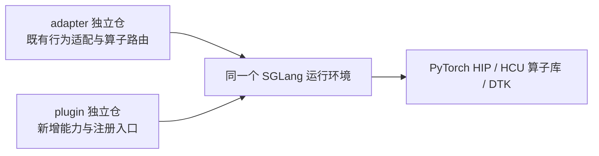

# hcu-sglang-plugin

面向海光 HCU 的 SGLang 插件开发仓库。目标是通过 SGLang 扩展点、注册机制和精确 Hook 引入算子融合、专项内核、新后端与调度能力，并让这些能力可以独立开发、验证和停用。

**当前交付：文档、4 个 skill、7 个开发工具和 CPU 工具测试。运行时插件包尚未实现。** 本仓无需 `pip install -e .`，也没有可直接启用的 `hcu` entry point。未来运行时目录与接入方式见 [架构设计](docs/architecture.md)。

## 1. 与 adapter 的关系

`hcu-sglang-adapter` 与本仓是**独立开发、按职责协作、运行时可组合**的仓库。adapter 补齐上游已有行为在 HCU 上的兼容性，并持续优化；plugin 承载上游没有的新能力，也可以优化性能。同一业务需求可能需要两仓各自完成一部分工作，部署时并非二选一。



两仓可共同调用 LightOp、AITER 等库；plugin 也可直接使用适用的底层库。组合前要核对版本、目标所有权、加载顺序及 fallback，不能仅凭单仓测试通过宣称组合可用。详细契约见 [职责与兼容治理](docs/governance.md)。

## 2. 从哪里开始

| 你的任务 | 首先阅读 | 可直接使用的入口 |
|---|---|---|
| 第一次接手 | [文档导航](docs/README.md)、[架构设计](docs/architecture.md) | 根 README → 按任务阅读 |
| 准备环境、使用现有工具 | [环境准备与快速使用](docs/bootstrap.md) | Python 3.10+、Git，无运行时包安装 |
| 开发一个新能力 | [插件开发指南](docs/plugins.md)、[协作流程](docs/contributing.md) | [hcu-plugin-dev](skills/hcu-plugin-dev/SKILL.md) |
| 同步 DAS fork / 升级插件 | [三方迁移手册](docs/migration.md) | [sglang-dcu-plugin-migration](skills/sglang-dcu-plugin-migration/SKILL.md) |
| 生成源码内嵌仓库 | [源码回溯手册](docs/backtracking.md) | [hcu-plugin-backtrack](skills/hcu-plugin-backtrack/SKILL.md) |
| 排查精度 / graph / hang / 性能 | [验证与排障](docs/validation.md) | [hcu-plugin-triage](skills/hcu-plugin-triage/SKILL.md) |
| 查看门禁与交付证据 | [CI 与质量门禁](docs/ci.md)、[交付记录](docs/delivery-validation.md) | 当前 CPU gate 与后续组合验证分开 |

## 3. 环境准备与第一次运行

先将 `REPO` 替换为自己的完整路径；NMZ_zz_26 现有路径如下。`python3` 必须为 3.10+，节点默认 3.6 不满足要求，请选合适解释器或已挂载本目录的开发容器。

```bash
REPO=/public/home/yangyn1/work_space/2026/sglang_main/sglang-plugin/hcu-sglang-plugin
cd "$REPO"
python3 --version
git --version
python3 ci/l0_gate.py
python3 -m unittest discover -s tests -v
python3 tools/reconstruct_sglang_das.py --help
```

本库的离线门禁与工具测试只需要 Python 标准库和 Git。真实 Hook 签名校验会导入**外部** SGLang/plugin，另需匹配的运行时依赖；详见 [环境边界](docs/bootstrap.md)。

## 4. 使用 skill 和工具

给 agent 提供仓库路径、输入仓库路径及产物目录，并让它读取对应 `SKILL.md`。例如：

```text
读取 <repo>/skills/sglang-dcu-plugin-migration/SKILL.md。
官方仓库是 <official>，DAS 来源是 <fork>，外部插件仓库是 <plugin>；
把审计产物写入 <repo>/artifacts/migration，先审计并列出台账。
```

skill 按需引用共享 docs/tools；复制到其他位置时保留整库目录。仅复制某个 skill 子目录会丢失共享资源；不假定某个客户端一定自动发现这些目录。完整使用方式见 [快速使用手册](docs/bootstrap.md)。

| 工具 | 用途与边界 | 操作手册 |
|---|---|---|
| `audit_repositories.py` | 文件哈希、AST 和字面目标；候选不等于生效 | [迁移](docs/migration.md) |
| `build_migration_manifest.py` | merge-base、WORKTREE 与继承硬件漂移 | [迁移](docs/migration.md) |
| `build_disposition_ledger.py` | 生成待审计台账，区分 AST / runtime-export | [迁移](docs/migration.md) |
| `sync_deepseek_methods.py` | 历史 DCU DeepSeek 布局同步；先用 `--check` | [迁移](docs/migration.md) |
| `validate_hook_signatures.py` | 外部已注册 models REPLACE Hook 的签名子集 | [迁移](docs/migration.md) |
| `reconstruct_sglang_das.py` | 两个干净输入 → 新源码内嵌 Git 仓库 | [回溯](docs/backtracking.md) |
| `verify_reconstruction.py` | 清单文件 SHA256 / 缺失 / 越界检查 | [回溯](docs/backtracking.md) |

脚本均位于 `tools/`。本方法库不能充当回溯工具的 `--plugin` 输入，该参数需要含 `sglang_dcu_plugin` 的外部实现仓。

## 5. 目录与设计要点

```text
README.md                 项目定位、使用和开发入口
architecture.html         可在浏览器直接打开的架构导览
AGENTS.md                 仓库内 agent 工作约定
docs/                     导航、架构、治理、操作、协作、证据
skills/<task>/            SKILL.md、agents 元信息、按需 references
tools/                    唯一的开发工具实现
templates/                处置输入、历史记录、验证记录模板
tests/                    隔离 Git fixture 工具测试
ci/ + .workflow/          离线门禁与尚待平台接入的 runner 配方
artifacts/                本地执行产物，Git 忽略
```

运行时规划见 [未来目录设计](docs/architecture.md#4-未来运行时目录规划)。图文导览可打开 [architecture.html](architecture.html)。当前不创建空业务目录，也不把规划目录或 entry point 描述为已实现。

## 6. CI 与验收

| 检查 | 当前状态 | 能证明什么 |
|---|---|---|
| `python3 ci/l0_gate.py` | 已有、可手动执行 | Python 语法、skill 资源、相对文件链接、当前阶段的运行时代码排除 |
| `python3 -m unittest discover -s tests -v` | 已有，14 项工具行为测试 | 审计、清单、台账、回溯和核验的隔离工具契约 |
| `.workflow/l0-gate.yml` | runner 命令配方 | 未绑定托管平台，不能声称 push/MR 自动执行 |
| plugin 接线 / HCU 数值 / graph / 服务 / 性能 | 后续实现与资源就绪后执行 | 按能力和部署组合分别验收，CPU 通过不替代这些结果 |

详细入口、失败处理和计划见 [CI 手册](docs/ci.md)。历史与当前验证按版本分开记录在 [交付记录](docs/delivery-validation.md)。

## 7. 开发约束

- 两仓各自维护实现与版本；跨仓需求拆成有依赖关系的任务，并记录兼容版本组合。
- 优先上游 seam/注册机制，必要时选择窄 Hook。正式部署不从 DAS fork 导入实现，日常开发不改官方工作树。
- 从 entry point 验证完整注册链、目标集合和组合顺序；AST 候选、注册成功、apply 成功和行为正确分别提供证据。
- fallback 保留当前有效基线；adapter 启用时可能回到已适配路径，不能假设 `original_fn` 永远是未经适配的官方原函数。
- 可选依赖懒加载；缓存写入、conv/Mamba 状态、collective 和 graph 都是行为契约，不用宽泛异常捕获掩盖错误。
- 规则、skill、操作手册与实现同变更维护。共享节点操作限定到任务资源，日志和生成树放在忽略目录。

提交前按 [协作检查清单](docs/contributing.md) 自查；配置的所有权与覆盖顺序见 [配置管理](docs/configuration.md)。

## 8. 来源与版本

V1 来源包括 `hcu-sglang-adapter`、`sglang-plugin-das`、DAS 的 25 项 skill 和 `plugin_work` 回溯工具。V2 重整架构、文档导航、操作与协作说明，不引入运行时插件代码。来源和历史快照的使用边界见 [抽取地图](docs/extraction-map.md)；许可与归属见 [NOTICE](NOTICE) 和 `licenses/`。
