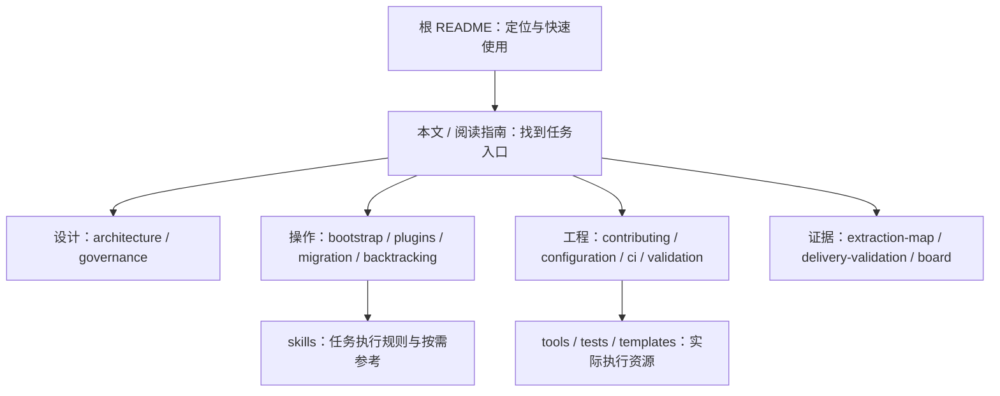

# 文档中心

> **本文用途**：作为 docs 的统一入口，说明每份文档负责什么、何时阅读以及如何维护。首次使用时选择下表任务入口；任务分类见 [阅读指南](reading-guide.md)。

## 任务入口

| 任务 | 操作文档 | 执行 Skill |
|---|---|---|
| 插件工程初始化 | [工程初始化指南](first-plugin.md) | [hcu-plugin-scaffold](../skills/hcu-plugin-scaffold/SKILL.md) |
| 插件安装与加载验证 | [安装与启用指南](installation.md) | [hcu-plugin-install](../skills/hcu-plugin-install/SKILL.md) |
| 插件能力开发 | [能力开发指南](plugins.md) | [hcu-plugin-dev](../skills/hcu-plugin-dev/SKILL.md) |
| 故障诊断与回归修复 | [故障诊断指南](troubleshooting.md) | [hcu-plugin-triage](../skills/hcu-plugin-triage/SKILL.md) |
| 三方差异审计与迁移 | [三方迁移指南](migration.md) | [sglang-dcu-plugin-migration](../skills/sglang-dcu-plugin-migration/SKILL.md) |
| 官方版本升级与发版 | [版本升级与发版指南](upgrading.md) | [upgrading-sglang-hcu-upstream-first](../skills/upgrading-sglang-hcu-upstream-first/SKILL.md) |
| 内嵌源码生成与核验 | [源码回溯指南](backtracking.md) | [hcu-plugin-backtrack](../skills/hcu-plugin-backtrack/SKILL.md) |

每份操作文档包含本任务的输入要求、Skill 调用示例、执行范围和验收标准。[任务与 Skill 使用指南](reading-guide.md) 负责选择与衔接；下列目录用于按需查询设计、规则与历史证据。

## 1. 文档组织

设计文档回答“为什么这样组织、组件如何协作”；操作手册回答“需要什么、执行什么、检查什么”；规则文档约束开发和验收；证据文档保存版本和结论。相同命令与详细规则只维护一处，其他页面链接过去。

## 2. 文档目录

| 文档 | 主要内容 | 何时阅读 | 维护触发点 |
|---|---|---|---|
| [根 README](../README.md) | 定位、状态、首次使用、要点、CI 与约束 | 所有人首次接手 | 新能力/入口/阶段变化 |
| [任务与 Skill 使用指南](reading-guide.md) | 任务、操作文档与 Skill 的对应关系 | 准备开始一个任务 | 新增或调整文档职责 |
| [架构设计](architecture.md) | 独立仓与组合运行、现有目录、未来结构 | 设计或评审接口 | 包、目录、依赖关系变化 |
| [职责治理](governance.md) | 代码归属、跨仓依赖、目标所有权、证据状态 | 拆需求、处理重叠目标 | 边界或兼容规则变化 |
| [安装与启用](installation.md) | wheel/editable、入口、实际加载、服务与停用 | 使用已有运行时插件 | 运行时版本/安装/加载方式变化 |
| [工程初始化指南](first-plugin.md) | 创建包→安装→真实 Hook→启停断言 | 第一次开发插件 | pinned API 或案例变化 |
| [故障诊断指南](troubleshooting.md) | 症状分类、TP4 生成异常案例与 Skill 衔接 | 已有安装/加载/运行故障 | 新的可操作诊断路线 |
| [环境准备](bootstrap.md) | 工具环境、Skill 使用、外部实现接入 | 第一次执行工具 | Python/依赖/安装方式变化 |
| [配置管理](configuration.md) | 路径变量、配置所有权、覆盖与记录 | 新增开关、组合运行 | 参数/默认值/来源变化 |
| [开发经验与故障案例索引](development-methodology.md) | 上次故障的症状、检查方法、修复经验和适用边界 | 遇到相似问题时查询 | 有实证的新排障经验 |
| [插件开发](plugins.md) | 新能力从设计、注册到验证的步骤 | 新增或修改能力 | seam、Hook 或状态契约变化 |
| [三方迁移](migration.md) | official/fork/plugin 审计、清单和台账 | 同步 fork、升级官方版本 | 工具参数或外部布局变化 |
| [源码回溯](backtracking.md) | 生成内嵌源码树、保护与哈希核验 | 复现/交付 embedded 树 | 注入 anchor 或清单变化 |
| [协作流程](contributing.md) | 需求、分支、跨仓评审、提交清单 | 参与改动与交接 | 协作流程或阶段变化 |
| [CI 与门禁](ci.md) | 当前命令、检查边界、未来运行时 gate | 提交前、维护 CI | runner/gate/检查项变化 |
| [验证与排障](validation.md) | 接线/数值/graph/服务/性能、组合矩阵 | 验收或定位问题 | 新 lane、阈值或证据要求 |
| [任务与路线](board.md) | 后续实施条件与任务字段 | 领取下一项工作 | 负责人/状态/接受条件变化 |
| [来源地图](extraction-map.md) | 固定来源、抽取取舍、V1/V2 关系 | 审核来源或更新方法 | 新来源或方法重写 |
| [V3 2026-10-26 实施记录](v3-20261026-development.md) | 当前输入、已实现模块、逻辑对照与本轮验证 | 接手本轮交付或复核 HCU 逻辑差异 | 当前来源、实现或验证结果变化 |
| [V3 实践](v3-runtime-validation.md) | 指定源码/容器上的输出、问题和可复现验证 | 运行本次或相同 profile | 源码/接口/实际结果变化 |
| [版本升级与发版](upgrading.md) | 升级工作流、Skill 调用、补丁处置与验收 | 指定官方目标升级或发布交付 | 升级流程或验收契约变化 |
| [vLLM Skill 迁移](vllm-skill-migration.md) | 方法取舍、SGLang 改写和新增升级发版入口 | 升级/发版、维护来源与能力边界 | 来源或方法迁入变化 |
| [交付记录](delivery-validation.md) | 按版本保存范围、命令和验证结果 | 核对本次完成情况 | 一次交付实际完成后 |

浏览器导览为 [architecture.html](../architecture.html)，详细规则仍以 Markdown 原文为准。

## 3. 数据快照与执行资源

| 资源 | 作用 | 使用边界 |
|---|---|---|
| [source-inventory.json](source-inventory.json) | V1 中 DAS 25 项 Skill 的原始描述、源哈希、取舍和目的地 | 历史抽取索引；不是运行时能力清单 |
| [source-manifest.json](source-manifest.json) | V1 来源 SHA 与抽取时的源/目标文件哈希 | V1 快照；目标文件未来修改后不能当当前全仓完整性清单 |
| [skills/](../skills) | 7 个任务入口、agents 元信息和按需参考 | 保留共享相对路径 |
| [tools/](../tools) | 9 个工具的唯一源码 | 用 `--help` 和对应操作手册 |
| [templates/](../templates) | 人工处置、历史和验证记录 | 复制后填写真实证据，不复用旧 verified |
| [tests/](../tests) / [ci/](../ci) | 工具契约与结构门禁 | CPU 工具结论不外推成运行时已验证 |
| `artifacts/` | 本次执行日志、清单和本地产物 | Git 忽略；共享证据时另保存稳定位置 |

## 4. 文档编写约定

每篇操作/设计文档采用“明确标题 → 本文用途 → 输入/范围 → 主体步骤或设计 → 结果与边界 → 相关入口”。不要求每篇都堆满相同章节，但读者应能找到目的、执行条件和输出。

| 情况 | 表达方式 |
|---|---|
| 多个组件、职责或选择 | 表格对比，明确“归属”与“运行组合”分别是什么 |
| 生命周期、调用链、协作阶段 | Mermaid 流程图或时序图；节点注明当前/规划 |
| 操作命令 | 声明工作目录、输入变量、依赖和写入目标；给检查方法 |
| 未来功能 | 标记“规划/提案/未实现”，不写成当前可运行命令 |
| 历史验证 | 固定日期、版本、环境与范围，不把旧数字迁入新结论 |
| 新增页面 | 更新本页、阅读指南和相关 Skill 路由，检查链接与标题 |

文件路径保留稳定，文档标题体现主题；`plugins.md`、`bootstrap.md`、`board.md` 等沿用现有路径以保持引用兼容，不要求标题重复文件名。

## 5. 术语与 Skill 文档规范

标题采用“对象＋操作/职责”的技术表述，如“插件工程初始化指南”“安装、入口与加载验证”“修复验收标准”。导航表统一使用“任务类型、操作指南、对应 Skill、验收标准”，避免口语化问题句。正文采用“插件”，代码标识、包名和路径保持原文；Skill、Agent、Hook、Graph 采用统一大小写。

存在独立执行目标的操作文档应包含“使用 Skill …”章节，列出适用 Skill、必需输入、调用示例、预期交付及后续任务边界。优先复用职责匹配的现有 Skill；只有任务输入、执行流程和验收标准与现有入口明显不同时才新增，避免按页面数量复制 Skill。设计规范与历史记录无需分别创建执行 Skill。

操作细节与示例维护在对应文档，Skill 保留任务决策、约束和引用；二者互相链接。新增 Skill 同步任务导航、元信息、数量与结构检查，保持完整仓库的共享相对路径。
