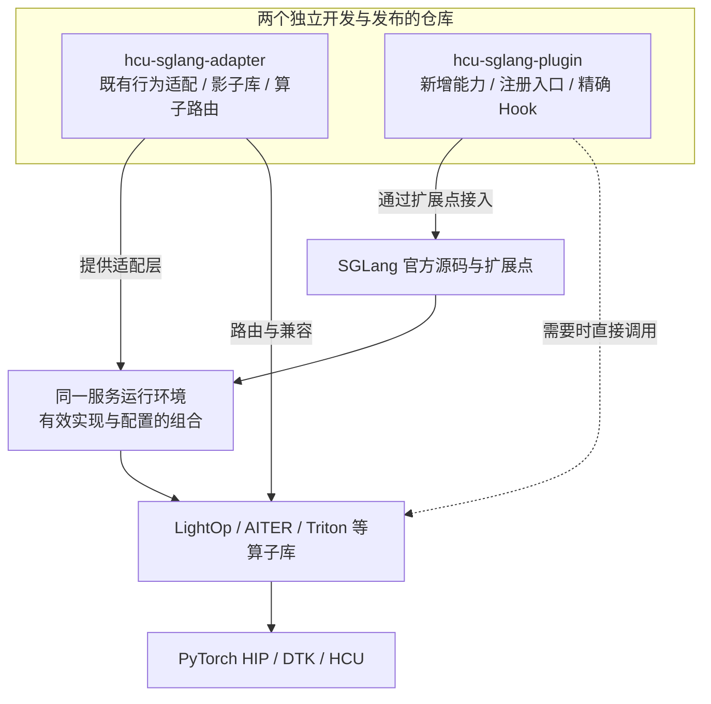
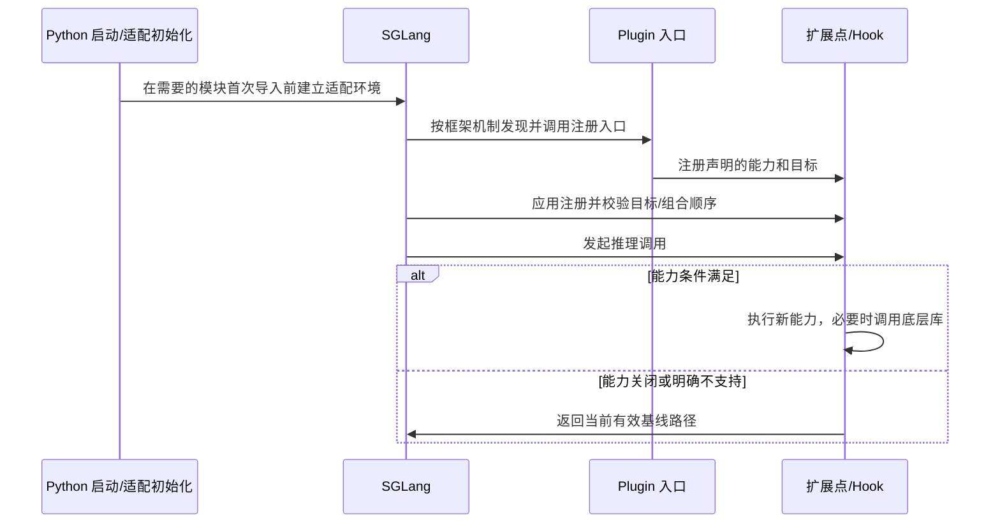

# 架构设计：独立开发与组合运行

> **本文用途**：解释 adapter、plugin、SGLang 与算子库的关系，定义本仓设计目标、现有目录和未来运行时结构，并给出导航与协作入口。用于评审方案和规划实现；具体操作见 [开发指南](plugins.md)，职责规则见 [治理](governance.md)。

## 1. 设计目标与当前阶段

| 目标 | 设计要求 | 当前状态 |
|---|---|---|
| 独立开发 | adapter/plugin 各自维护代码、版本与验证，不把两个仓库合成一个 glue 单体 | 文档与职责契约已建立 |
| 组合运行 | 同一个 SGLang 环境可同时使用 adapter 与 plugin，显式验证目标冲突及加载顺序 | 组合契约已设计；本仓运行时尚未实现 |
| 可追溯扩展 | 新能力通过 seam/注册/窄 Hook 接入，记录目标、条件、依赖和回退 | Skill、迁移台账与工具已提供 |
| 可验证交付 | 接线、数值、Graph、服务与性能证据逐层递进 | CPU 工具验证已提供；运行时门禁为规划 |
| 可维护文档 | 导航、设计、操作、规则与历史证据各有归属 | 文档按 [文档索引](README.md) 组织 |

本仓目前包含方法、Skill 与工具。下文中“参考实现”指外部 `sglang-plugin-das`；“未来规划”指本仓尚未落地的业务包。**独立开发不等于没有运行时依赖**：某能力若需要 adapter 提供的符号或环境行为，必须声明并验证这个依赖。

## 2. 运行时组合关系



图中两条仓库线汇入同一运行环境，**没有按需求二选一的分支**。职责判别只决定某份实现由谁维护；一个功能可拆为 adapter 的 ABI 补齐和 plugin 的融合调用两项工作，最终一起验证。

| 组件 | 主要职责 | 与其他组件的关系 |
|---|---|---|
| 官方 SGLang | 模型/调度运行时、扩展点、Hook 应用机制 | 是两仓共同集成的基线 |
| adapter | 还原上游既有行为在 HCU 上的可用性，维护兼容与算子路由 | 可单独适配官方 SGLang，也可支撑 plugin 所需的基线能力 |
| plugin | 提供新增融合、后端或机制，管理自身注册、能力选择与回退 | 通过 SGLang seam/Hook 接入，可使用 adapter 或直接调用适用算子库 |
| 算子库与运行时 | 数学实现、编译执行、通信与设备支持 | 可由两仓使用，依赖版本需纳入组合记录 |

这里只描述责任和集成模型，不承诺每个历史版本都能直接组合。具体行为边界依据 adapter 的 `docs/governance.md` §0/§1 与 `docs/architecture.md` 软件分层说明；固定来源见 [抽取地图](extraction-map.md)。

### 2.1 加载与回退契约



这是**组合实现需满足的时序契约**。adapter 的导入期初始化必须早于依赖它的模块冻结状态；plugin 的注册与运行时计算分开。实际 Hook 顺序、包装链与旧别名处理必须在固定 SHA 上验证，不能只看 `PYTHONPATH` 顺序推断。

`original_fn` 表示 Hook 框架传入的当前函数，可能已经过 adapter 或另一层合法包装。fallback 要保留该有效基线，不能私自重新 import 一个“原版”函数绕过适配。多个组件触达同一目标时先定义所有权与组合顺序，再做集成测试。

## 3. 当前仓库目录与导航

```text
hcu-sglang-plugin/
├── README.md                  使用入口与项目状态
├── architecture.html          浏览器架构导览
├── AGENTS.md                   agent 工作约定
├── docs/
│   ├── README.md               文档地图与阅读顺序
│   ├── reading-guide.md        任务路由与失效信号
│   ├── architecture.md         本文：关系、分层与目录规划
│   ├── governance.md           职责与组合兼容规则
│   ├── contributing.md         需求到评审的协作流程
│   ├── bootstrap.md            环境准备与快速使用
│   ├── configuration.md        路径、开关和配置所有权
│   ├── plugins.md              新能力开发操作
│   ├── migration.md            三方审计与升级操作
│   ├── backtracking.md         源码回溯与核验操作
│   ├── validation.md           验证矩阵与排障方法
│   ├── ci.md                   当前门禁与未来集成计划
│   ├── board.md                后续工作与接受条件
│   ├── extraction-map.md       方法来源和取舍
│   └── delivery-validation.md  按版本记录交付证据
├── skills/<task>/              7 个任务 Skill 与按需参考
├── tools/                      9 个开发工具的唯一实现
├── templates/                  历史、处置与验证模板
├── tests/                      CPU 工具行为测试
├── ci/                         离线结构门禁
├── .workflow/                  runner 配方，尚未接入托管平台
├── licenses/                   来源许可（归属见 docs/extraction-map.md）
└── artifacts/                  被忽略的本地执行证据
```

JSON 来源快照的职责见 [文档索引](README.md)。不在每个 Skill 下复制工具；同一规则的详细版放在一处，其他入口提供链接。

## 4. 未来运行时目录规划

以下名称是**提案**，不是已存在目录、可安装包或稳定 API。首次实现需先确认包名、entry point、支持的官方版本与依赖，再同步调整当前 L0 的“禁止运行时代码”阶段约束。

```text
hcu-sglang-plugin/                 未来在当前方法库基础上逐步增加
├── pyproject.toml                打包元数据、依赖、SGLang entry point
├── hcu_sglang_plugin/            运行时包名提案
│   ├── __init__.py               单一对外注册入口，保持轻量
│   ├── registration.py           聚合、顺序与重复注册处理
│   ├── capabilities.py           硬件/版本/依赖能力判定
│   ├── config.py                 plugin 自有配置与来源记录
│   ├── features/<feature>/       新能力按功能域组织
│   │   ├── hooks.py              扩展点映射、门控与 fallback
│   │   ├── implementation.py     本能力实现或底层库调用
│   │   └── contracts.py          输入/输出/状态契约（需要时）
│   ├── models/<family>/          确有模型专属逻辑时再创建
│   └── integrations/             与框架/adapter 的显式兼容接缝
├── tests/runtime/                注册/目标/配置/回退测试
├── tests/integration/            官方、plugin、adapter 组合测试
├── tests/kernels/                能力涉及自有数学时的数值/graph 对拍
├── tests/bench/                  预热后性能测量
├── examples/                     最小插件和经验证的使用配方
└── ci/                          在现有 L0 上增加适用运行时门禁
```

| 模块边界 | 应放内容 | 不应混入 |
|---|---|---|
| 注册入口 | 功能聚合、声明、顺序、可诊断结果 | 大量模型实现或立即启动服务 |
| 能力与配置 | 真实设备/版本/依赖判定、显式覆盖 | 各 Hook 中重复、互相矛盾的探测 |
| feature Hook | seam 目标、窄门控、基线回退 | 无来源的整类复制与重复注册 |
| feature 实现 | 新能力逻辑、声明的底层依赖 | 从 DAS 工作树动态 import |
| integration | 两仓组合的版本/符号契约 | 把 adapter 全部实现再复制一份 |

历史 `sglang_dcu_plugin/models/<family>/hooks + methods` 是已有工具支持的外部布局。新包名或目录变化时要改工具适配与测试，不假定历史工具自动支持新结构。

## 5. 开发与协作闭环


| 阶段 | 最小产物 | 主要入口 |
|---|---|---|
| 需求 | 行为、输入范围、涉及仓库、接受条件 | [任务看板](board.md) |
| 设计 | seam、目标所有权、依赖与回退、版本矩阵 | [治理](governance.md)、[配置](configuration.md) |
| 实现 | 聚焦改动、对应测试、文档/skill 更新 | [开发指南](plugins.md)、[开发 Skill](../skills/hcu-plugin-dev/SKILL.md) |
| 验证 | 单仓和组合结果、缺失 lane 与原因 | [验证手册](validation.md)、[CI](ci.md) |
| 评审/合入 | 变更清单、兼容组合、风险和停用方式 | [协作流程](contributing.md) |

跨仓协作不要求互相拷贝实现或同步发布节奏。若 A 版本依赖 B 的某个接口，分别提交并明确最低兼容版本；组合验证后再更新支持记录。

## 6. 设计评审检查

- 图中是否保留两仓独立且可组合的关系？是否把实现归属误画成运行时二选一？
- 新能力依赖的是上游 API、adapter 能力还是 vendor 符号？缺失时如何处理？
- 同一目标是否存在多层修改？是否记录加载顺序、包装链与 alias 行为？
- 当前已有内容与规划目录、计划 gate 是否明确分开？
- 是否能从需求找到目录、Skill、命令、测试和交付记录？

下一步：设计接口读 [governance](governance.md)，开始开发读 [plugins](plugins.md)，参与协作读 [contributing](contributing.md)。
