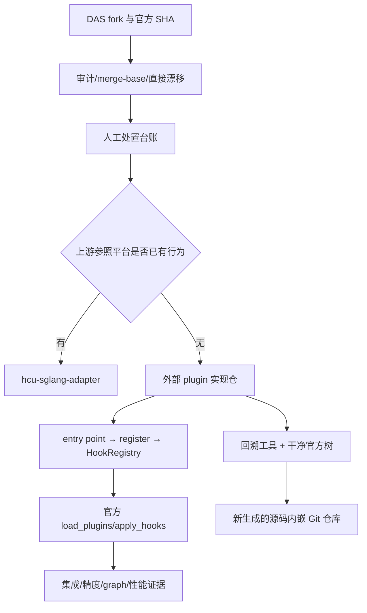

# 架构与生命周期

本库提供 B/C/I/J 的方法和工具；F/G 是外部实现仓职责。`docs/` 解释设计与命令，`skills/` 为 agent 按任务提供入口，`tools/` 维护唯一脚本副本，`templates/` 是台账输入和验证记录格式，`tests/` 验证工具行为，`ci/` 提供 CPU 结构门禁。

## 参考 plugin 的加载模型

以读取的 `sglang-plugin-das` 为例：`pyproject.toml` 的 `sglang.srt.plugins` 分组声明 `dcu = sglang_dcu_plugin:register`；SGLang 按 `SGLANG_PLUGINS` allowlist 选择入口，所有入口注册结束后统一 apply。顶层入口先建立 AITER 兼容和环境注册，再聚合 server args、distributed、attention/MoE/quant、cache、models 和多模态 Hook。注册与执行是两个阶段；运行时再按设备、shape、dtype、模式和依赖决定新路径或 official fallback。

目标字符串经框架解析到属性；`from X import Y` 缓存别名、注册顺序、多个 AROUND 的组合都属于契约。不能仅按源码 grep 出的字符串统计生效功能。

旧 `repository_logic_brief_zh.md` 声称 DeepSeek 未接到顶层入口；当前读取的入口已有 `register_deepseek()`。本库提取可复用机制，现状以 pinned SHA 的源码和实际注册测试为准，不复制过时结论。

## 与 adapter 的组织对应

| adapter 组织 | 本库承接 |
|---|---|
| README / docs/reading-guide | 入口与任务导航 |
| architecture / governance / plugins | 双仓选位、生命周期、Hook 契约 |
| skills/hcu-adapter-dev/references | 四个任务 skill 与按需参考 |
| tools | 审计/迁移/回溯/哈希核验 |
| tests / ci / .workflow | 工具行为测试与离线 L0 |
| models / board | 验证记录模板与后续集成事项 |

不复制 adapter 的 sitecustomize、影子库、kernel、运行时注册表或配置 UI；这些属于已有运行时系统，方法库不能声称提供相同能力。
