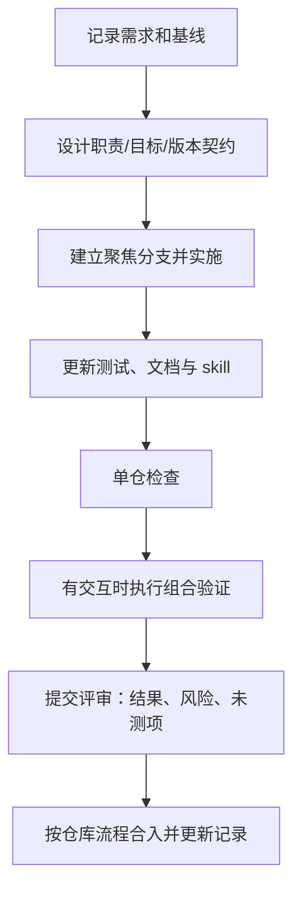

# 协作流程：需求、开发、评审与交接

> **本文用途**：定义如何在本仓及与 adapter 的协作中推进一项改动，避免版本、职责与证据脱节。开始工作前读 [架构](architecture.md) 和 [治理](governance.md)，执行检查时读 [CI](ci.md)。

## 1. 需求进入与任务拆分

| 字段 | 需要说明的内容 |
|---|---|
| 行为与范围 | 新增/修复什么；shape、dtype、模型、并行或运行模式 |
| 来源与基线 | official、plugin、adapter（使用时）及 fork 的 SHA/dirty |
| 涉及仓库 | 单仓任务或跨仓子任务；每仓承担的实现和接口 |
| 依赖与回退 | 扩展点、vendor 符号、最低版本、关闭后回到哪条基线 |
| 接受条件 | 具体断言、适用组合、数值/服务/性能 lane |
| 执行与证据 | 负责人、分支、产物位置、资源需求及待解决条件 |

在 [任务看板](board.md) 记录入口；复杂迁移再链接处置台账。不要把“需要同时部署”解释为“全部代码必须进同一仓”。

## 2. 开发流程

分支名可采用 `docs/<topic>`、`feat/<capability>`、`fix/<cause>` 或 `tools/<topic>`。这是建议命名，不代表已建立分支保护或固定上游分支。开始前检查当前 branch、status 与用户未提交内容；不在脏树中 reset/clean 来迎合工具。

跨仓改动各自提交，评审说明互相引用依赖的 commit/接口和兼容组合。未合入的前置变更不能被描述成已发布支持。

## 生成代码约定

创建、抽取、迁移、升级或回溯 plugin/embedded 源码时，不额外添加说明性注释、BEGIN/END 生成标记、来源说明 docstring 或 `noqa` 等 lint 抑制注释。生成器仅补充必要的可执行代码、导入和配置；来源已有注释、docstring、版权和许可声明保留，不做全文件去注释。

来源、设计理由、迁移映射和验证结果写入独立文档、处置台账或来源 manifest。交付前审查相对输入的 diff，区分继承内容与新增内容；注释中的路径和关键字不应因标识符重写而变化。重复注入检查使用导入符号与旧标记检测，仍须拒绝已集成输入，不靠写入新注释定位。

## 3. 按改动类型检查

| 改动 | 必需检查 | 对应文档 |
|---|---|---|
| 仅文档/skill | 标题与用途、路径/锚点、当前/规划区分、规则一致；执行 L0；Skill 改动做元信息校验 | [文档约定](README.md)、[CI](ci.md) |
| 工具行为 | 对应实际契约测试与 L0；保留输入/输出保护 | [迁移](migration.md)、[回溯](backtracking.md) |
| 首次运行时实现 | 先审查目录、entry point、依赖和阶段 gate；增加对应测试 | [架构规划](architecture.md#4-未来运行时目录规划) |
| 新能力或 Hook | 顶层可达、目标解析、签名/顺序、支持与回退、状态副作用；适用 GPU/组合 lane | [开发](plugins.md)、[验证](validation.md) |
| 配置或依赖 | 所有者、默认、显式覆盖、最低版本和组合测试 | [配置](configuration.md) |

## 4. 提交与评审内容

提交信息说明问题和结果，不只写“更新代码”。评审描述至少包括：

- 具体触发条件、原行为和目标行为；文档改动说明读者现在能完成什么。
- 涉及仓库、版本及目标；同一调用链多层改动时说明顺序与所有权。
- 实际执行的检查、环境、断言和结果；未执行项及原因。
- 配置/能力停用后的有效基线、兼容限制与后续工作。

评审检查新 capability 是否完整接入入口；文档和代码是否同变更；性能结论是否有同环境预热 A/B；日志是否证明所声称的分支实际命中。合入及推送按用户授权和仓库现有流程执行，文档中的流程不自动授权外部发布。

## 5. 共享节点与产物管理

来源仓库只读审计，回溯输出放新的、不与输入重叠的目录。测试和探针默认仅操作本任务资源，不自行停止其他服务来制造空闲。用户明确授权处理某个 GPU 冲突时，以 GPU→宿主 PID→cgroup→完整容器 ID 核实归属，并遵守节点权限；权限拒绝记录为未完成，不绕过控制。实际等待/重试与清理见 [资源排障](../skills/hcu-plugin-triage/references/distributed-and-performance.md)。大体积日志、模型数据、dump 与生成仓库不纳入本方法库；使用 `.gitignore` 已覆盖的 `artifacts/`、`outputs/` 或专用输出目录。

交接时保留可重放命令、稳定证据位置、适用 SHA 与未覆盖条件，更新 [交付记录](delivery-validation.md) 和 [看板](board.md)。本地 ignored 日志不是 Git 历史的一部分，长期留存需要另行明确位置。
