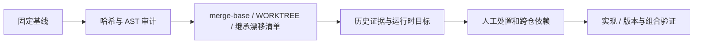

# 三方迁移手册：差异审计、处置与版本升级

> **本文用途**：将 official、DAS fork 和外部 plugin 的差异整理成可追溯清单与处置台账，并给出方法同步和签名检查入口。用于 fork 同步、官方升级和覆盖审计；skill 入口见 [三方迁移](../skills/sglang-dcu-plugin-migration/SKILL.md)。

## 1. 输入、前提与流程

| 输入 | 必需信息 | 作用 |
|---|---|---|
| official / fork / 外部 plugin | 绝对路径、branch、SHA、dirty | 三方比较和调用链来源 |
| adapter（组合使用时） | SHA、提供的符号/行为、目标交互 | 区分实现归属与部署组合 |
| 产物目录 | 可写、不混入来源工作树 | 清单、目标导出、台账、日志 |
| 执行环境 | Python 3.10+、Git；运行时步骤另需外部依赖 | 区分纯审计与真实注册 |



审计允许记录脏输入，不得先 reset/clean。回溯要求干净输入，见 [回溯手册](backtracking.md)。职责归属按 [治理](governance.md) 拆分；官方 + adapter + plugin 可以是同一交付的目标组合，不是互斥去向。

命令均从本库根目录执行；先将变量替换成真实绝对路径。`PLUGIN` 必须指向外部实现仓，不能指向当前方法库。审计允许脏树并记录 WORKTREE；不得先 reset/clean。回溯对干净树的要求见单独手册。

```bash
OFFICIAL=/path/to/official-sglang
FORK=/path/to/sglang-das
PLUGIN=/path/to/sglang-plugin-das
ARTIFACTS="$PWD/artifacts/migration"
mkdir -p "$ARTIFACTS"
python3 tools/audit_repositories.py \
  --repo "official=$OFFICIAL" --repo "fork=$FORK" --repo "plugin=$PLUGIN" \
  --compare fork=official --output "$ARTIFACTS/repo_audit.json"
```

## 2. 固定基线与生成清单

记录各树 branch、HEAD、dirty 文件、解释器/容器和依赖版本。使用 fork 中已有且与 official SHA 一致的 ref；若没有，可导入本地对象到**新的**专用 ref，不改变工作树：

```bash
# 如该 ref 已存在先核对，不覆盖别人的 ref；不要假设上游分支叫 main。
OFFICIAL_SHA=$(git -C "$OFFICIAL" rev-parse HEAD)
AUDIT_REF="refs/audit/hcu-plugin/$OFFICIAL_SHA"
git -C "$FORK" fetch "$OFFICIAL" "$OFFICIAL_SHA:$AUDIT_REF"
git -C "$FORK" merge-base HEAD "$AUDIT_REF"
python3 tools/build_migration_manifest.py \
  --official-repo "$OFFICIAL" --fork-repo "$FORK" --plugin-repo "$PLUGIN" \
  --official-ref "$AUDIT_REF" --output-dir "$ARTIFACTS/manifest"
```

fetch 写入 fork 的 Git ref/对象，但不改源码。如果需要严格不动来源 Git 元数据，先在独立临时 clone 中执行。工具对 merge-base 之后的 fork/upstream 变化分组，同时追加 `direct_hardware_drift`，避免漏掉继承自旧基线、被当前 upstream 删除的硬件行为。硬件关键词只帮助找候选，不能据此排除无关键词的 cache/scheduler/模型改动。

## 3. 运行时目标与处置台账

在指定 official/plugin 运行环境中，从顶层入口导出目标（会执行 register；先确认来源导入路径）：

```bash
PYTHONPATH="$OFFICIAL/python:$PLUGIN" python3 - "$ARTIFACTS/registered_hook_targets.txt" <<'TARGETS'
from pathlib import Path
import sys
from sglang.srt.plugins.hook_registry import HookRegistry
from sglang_dcu_plugin import register
HookRegistry.reset()
register()
Path(sys.argv[1]).write_text(
    '\n'.join(sorted(HookRegistry._hooks)) + '\n', encoding='utf-8')
TARGETS
cp templates/disposition_overrides.json "$ARTIFACTS/overrides.json"
python3 tools/build_disposition_ledger.py \
  --manifest "$ARTIFACTS/manifest/migration_manifest.json" \
  --official-repo "$OFFICIAL" --fork-repo "$FORK" --plugin-repo "$PLUGIN" \
  --hook-targets-file "$ARTIFACTS/registered_hook_targets.txt" \
  --overrides "$ARTIFACTS/overrides.json" \
  --output-json "$ARTIFACTS/disposition_ledger.json" \
  --output-markdown "$ARTIFACTS/disposition_ledger.md"
```

没有运行环境时可省略 targets 文件获得 AST 候选台账。报告用 `hook_target_source` 区分 `ast-candidates` 与 `runtime-export`，分别填写 `candidate_hook_targets` 或 `registered_hook_targets`，另一项为 null。模块路径匹配的条目保持 pending，避免误报 implemented/active。即使来自 register，也尚未证明目标属性能 apply。逐项补充来源与行为、拆分 adapter/plugin 实现职责、记录运行组合并查历史 commit，人工审核后才更新 overrides；不要套用旧任务的验收结论。

## 4. 方法抽取与升级验证

下面两个工具保留历史 `sglang_dcu_plugin/models/deepseek` 布局，不能泛化到任意 plugin 名称。

```bash
# --check 只读；不加 --check 会改外部 PLUGIN 方法文件，需在计划开发的树内执行。
python3 tools/sync_deepseek_methods.py \
  --fork-python "$FORK/python" --plugin-root "$PLUGIN" --check
PYTHONPATH="$OFFICIAL/python:$PLUGIN" python3 tools/validate_hook_signatures.py \
  --official-python "$OFFICIAL/python" --plugin-root "$PLUGIN" \
  --output "$ARTIFACTS/hook_signatures.json"
```

签名检查只覆盖已注册的 `sglang_dcu_plugin.models` REPLACE Hook，比较参数结构、默认值数量等；不比较默认值语义，不覆盖所有 AROUND/BEFORE/AFTER、动态别名或全部类契约。必须另测完整预期 targets、重复/组合顺序、apply 解析、fallback 与模型语义。空集合不能当作完整通过。

输出 `history/model-pr-history-notes.md` 记录来源 commit、符号、影响的选型和回归风险；模板见 [history-notes](../templates/history-notes.md)。验收按 [validation](validation.md) 的适用矩阵，缺 GPU 的 lane 记 pending。


## 5. 输出、复核与常见误读

| 产物/现象 | 解释与下一步 |
|---|---|
| `repo_audit.json` | Git 跟踪/未忽略文件、哈希、AST；解析错误必须逐项查看 |
| `migration_manifest.json/.md` | 三方基线、fork/upstream/WORKTREE 和直接硬件漂移，仍需人工语义审阅 |
| `registered_hook_targets.txt` | 来自该次顶层 register 的目标，尚未证明 apply 和数值正确 |
| `disposition_ledger.json/.md` | 逐项处置与证据状态；空 overrides 不代表审计已完成 |
| official-ref 不匹配工作树 HEAD | 修正基线或使用对应的独立 checkout，不继续混合比较 |
| 没有硬件关键词 | 仍需检查调度、cache、量化或模型的通用行为变化 |
| 仅签名子集全绿或零行 | 不能推出整个 plugin 兼容，更不能推出 adapter/plugin 组合可用 |

九类处置与证据要求见 [migration-contract](../skills/sglang-dcu-plugin-migration/references/migration-contract.md)。跨仓任务分别引用依赖和兼容 SHA；同一台账可以包含两个仓的工作，但每份实现仍有明确所有者。

交付时报告条目总数及各状态/处置分布、AST/注册/apply 数量、未解析目标、静态与运行时结果、native/package 缺口。用 [验证模板](../templates/validation-record.md) 记录适用组合，按 [协作流程](contributing.md) 评审与交接。
