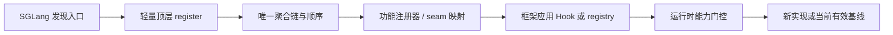

# 插件能力开发指南

> **本文用途**：指导新增或修改插件能力，包括职责拆分、扩展点、注册、fallback 与状态契约。当前用于本仓 `hcu_sglang/` 或用户指定的其他实现仓；迁入与验证状态见 [开发迁移记录](hcu-sglang-development.md)。架构规划见 [architecture](architecture.md)，开发规则入口为 [hcu-plugin-dev](../skills/hcu-plugin-dev/SKILL.md)。

## 使用 Skill 开发插件能力

对应 Skill：[`hcu-plugin-dev`](../skills/hcu-plugin-dev/SKILL.md)。该 Skill 将能力需求转为外部实现仓中的代码、注册与回归验证。创建全新插件包时先使用 [工程初始化 Skill](../skills/hcu-plugin-scaffold/SKILL.md)，然后按需要执行本指南。

**输入要求**：需求及支持范围、official/plugin 路径与 SHA、扩展点或目标、依赖、功能开关与回退基线、验收条件及证据目录；组合部署时包含 adapter 版本。

**调用示例**：将占位符替换为实际绝对路径与任务信息，提交给 Agent。

```text
读取 <方法库绝对路径>/skills/hcu-plugin-dev/SKILL.md，按该 Skill 执行。
官方源码：<路径及 SHA>；运行时插件仓库：<路径及 SHA>。
能力需求：<新增或修改的功能>；支持范围：<模型/dtype/shape/TP/Graph>。
依赖与扩展点：<已知信息>；关闭后的有效基线：<描述>。
adapter：<不使用，或路径/版本及组合要求>。
验收标准：<数值、状态、服务或性能的实际要求>。
证据目录：<本次任务目录>。
在指定运行时实现仓完成能力开发、顶层注册与支持/回退测试，执行相关验证并记录未执行项。
```

**预期交付**：能力设计、实现及注册变更、配置与回退说明、针对性回归测试和验证记录。本仓代码修改同步开发迁移记录、相关文档与方法。

## 开发范围与流程

新建独立插件包时，使用工程初始化 Skill 并参考 [最小案例](first-plugin.md)，用三个对照理解安装、发现、register、apply 与真实调用。若已有 `dcu` 实现仓，无需重建包，直接在该运行时仓改功能模块并沿现有顶层入口接入。

```text
需求和支持范围 → hcu-plugin-dev → 运行时仓实现/接入 → 回归与相关运行验证
                                        ↓ 遇到异常
                                hcu-plugin-triage → 最小复现 → 修复后回到验收
```

开发时主入口是 [hcu-plugin-dev](../skills/hcu-plugin-dev/SKILL.md)；遇到加载、数值、Graph、hang 或性能问题时转 [排障入口](troubleshooting.md)。从 fork 搬迁才使用 migration；官方目标升级才使用 upgrading；需要内嵌源码产物才使用 backtrack。它们不是每次开发必须依次执行的步骤。

例如给已有 HCU norm 增加一个 dtype/shape 分支：在实现仓写选中路径与 fallback，更新功能注册器和预期 targets；测试原参数/返回/状态、支持与不支持范围，再测本分支涉及的真实 GPU/Graph/模型行为。各阶段执行方法见下面 §1–§6，Agent 调用示例见本页“使用 Skill 开发插件能力”章节。

## 1. 需求与能力定义

| 输入类别 | 定义要求 |
|---|---|
| 行为 | 新增什么；上游已有行为中哪些部分需要 adapter 支撑 |
| 支持范围 | 哪些模型、shape/dtype、prefill/decode、Graph、并行与量化配置 |
| 基线 | official/plugin/adapter（使用时）的 SHA、当前有效实现与参数 |
| 接口 | 上游 seam/registry/Hook target、返回值、缓存与状态副作用 |
| 依赖 | 需要哪些 adapter 能力或 vendor 符号，最低版本与缺失策略 |
| 接受标准 | 数值、状态、服务和性能的具体断言及证据 |

先按 [治理](governance.md) 拆分代码归属，同时选择目标运行组合。一个需求可以同时产生 adapter 和 plugin 两个任务，不能因为最终共同部署就把两份职责混在一个实现体。

## 2. 扩展点与 Hook 选型

优先使用该 pinned SGLang 版本已有的后端、量化、runner 等扩展点；没有合适机制时再设计最窄 Hook。具体参数语义以该版本框架为准。先按 [所有权检查](development-methodology.md#4-moe-归约所有权与重复通信) 读真实 caller/readout/出口；框架已拥有的 norm、KV store 或 collective 不在复制方法里再执行。

| 机制 | 适用场景 | 需要保留的契约 |
|---|---|---|
| 正式 seam / registry | 框架已经允许新增实现或后端 | 标识唯一、接口、发现和选择逻辑 |
| AROUND | 按设备、形状、模式或依赖选择新路径 | `original_fn` 的有效基线及完整参数传递 |
| BEFORE | 参数转换足以完成任务 | 参数布局、默认值与状态变更 |
| AFTER | 结果转换或观察 | 返回结构、别名与副作用 |
| REPLACE | 完整拥有兼容实现 | 所有输入/输出/状态；替换类时另测类型行为 |
| module patch | 常量、registry 或缓存别名不是可调用目标 | 施加阶段、所有权、重复应用和旧引用 |

如果当前 API 无法安全表达行为，台账记 integration gap，说明所需的最小框架接缝；不要静默丢弃或用无限扩大的源码替换隐藏问题。

## 3. 实现组织与注册机制



| 层 | 组织要求 |
|---|---|
| 顶层入口 | 聚合清晰、依赖可诊断，不在模块导入时启动服务 |
| 功能映射 | Hook 目标、类型和门控独立于大段方法实现 |
| 实现代码 | 只依赖声明的包，不从 DAS 工作树取运行时代码 |
| 公共能力判定 | 明确真实硬件、版本和依赖，不重复猜测平台 |
| 组合接缝 | 声明与 adapter 的目标交互、顺序和 fallback |

未来本仓目录提案见 [架构 §4](architecture.md#4-未来运行时目录规划)。历史 DeepSeek 工具针对 `models/<family>/hooks + methods`，新包结构需要单独适配，不能直接套用。

从 entry point 验证完整预期目标集合；函数存在但顶层不可达不算接入。重复注册要明确拒绝或具有设计好的幂等语义；有意多 AROUND 组合时给顺序测试。不要同时开启两套旧 aggregator 来“补覆盖”。

## 4. 能力门控与基线回退

可选依赖在选中的路径内懒加载。明确不支持的设备、shape/mode 或依赖缺失可以回到支持的基线；真正的 kernel 错误、cache 错误与语义异常应保留可诊断失败，不做 broad except 静默回退。

| 组合问题 | 需要验证 |
|---|---|
| adapter 已包装目标 | plugin 正常调用与停用后均保留适配行为 |
| SGLang 暴露 CUDA 语义、设备实际 HIP | 能力探测基于真实设备/依赖，不用单一框架判定推断 vendor 能力 |
| 旧 import 别名仍指向旧函数 | 解析与实际调用一致，不只检查注册表 |
| 多个 Hook 包装 | 实际顺序、`original_fn` 传递、返回值和副作用一致 |

`original_fn` 可能是经过适配的当前函数，不能假定它是未经 adapter 修改的官方对象。配置与状态生命周期见 [configuration](configuration.md)。

## 5. 缓存、状态与 Graph 契约

| 行为面 | 常见遗漏 | 必需验证 |
|---|---|---|
| 融合 RMSNorm/RoPE/KV store | 融合已写 KV，后端又写一次 | 标记按 batch/layer 生命周期生效，下一请求无泄漏 |
| conv/Mamba/滑窗/checkpoint | 只验证当前输出，忽略后续复用 | 保存、恢复、淘汰和边界条件与重算一致 |
| 权重/量化 | 权重名、metadata 或尺度丢失 | 加载映射、dtype、scale 与分支一致 |
| collective | 旧方法与新框架边界重复求和，或 rank 门控/shape 不同 | 生产者/消费者 owner、group、次数、实际 TP>1 数值及空输入一致 |
| Graph | capture 正确而 replay 使用旧输入/状态 | 变输入、变状态 capture/replay 对拍；热路径不引入主机同步 |

## 6. 验证与交付流程

1. 先建立修复前会失败的真实边界回归和 reference/状态、支持-回退契约，再做整模型集成；[测试契约](../skills/hcu-plugin-dev/references/test-contract.md) 说明 mock 的边界。
2. 校验入口集合、目标解析、签名/别名/顺序；接线成功与数值正确分开记录。
3. 单仓通过后，执行所声明的组合、Graph、服务、精度与性能 lane。
4. 同步设计、配置说明、Skill 和 [验证记录](../templates/validation-record.md)。无法执行项保留 pending 或有理由的 not-applicable。

详细验证矩阵见 [validation](validation.md)，评审与提交内容见 [contributing](contributing.md)。
